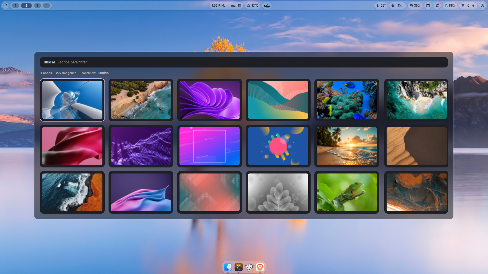

# rofi-wallselect

Selector de fondos de pantalla para **rofi** que aplica la imagen a través de
**DMS (DankMaterialShell / Dux Shell)**, por lo que se reproducen sus
transiciones animadas: fundido, barrido, disco, iris bloom, pixelado, portal…

Pensado para sesiones Wayland con DMS, pero incluye respaldos para `swww` y
`swaybg` si DMS no está disponible.



## Características

- Rejilla responsive de miniaturas (4, 5 o 6 columnas según la resolución).
- Búsqueda en vivo por nombre de archivo.
- Fondo del menú difuminado a partir del wallpaper actual.
- Preselecciona el fondo que tienes puesto.
- Miniaturas cacheadas y regeneradas automáticamente al añadir fondos.
- Notificaciones «Fondo cambiado» y «Tema aplicado».
- Aplicación por DMS con transiciones animadas; respaldo a `swww`/`swaybg`.

## Requisitos

Resumen: `rofi`, `bash` y, recomendado, `DMS`. Para miniaturas y fondo
difuminado hace falta `ImageMagick`.

Consulta el detalle y los comandos por distribución en
[REQUIREMENTS.md](REQUIREMENTS.md).

## Instalación

```bash
cd rofi-wallselect
./install.sh
```

El instalador:

1. Copia `wallselect.sh` y `style.rasi` a `~/.config/rofi/wallselect/`.
2. Instala `config.sh` solo si no existe (no pisa tu configuración).
3. Crea `~/.config/rofi/shared/{colors,fonts}.rasi` solo si faltan.
4. Genera la caché de miniaturas en `~/.cache/rofi-wallselect/`.
5. Respalda cualquier archivo previo como `*.bak.AAAAAMMDD-HHMMSS`.

Opciones:

```bash
./install.sh --no-thumbs   # no generar miniaturas ahora
./install.sh --help
```

También puedes usar `make install`, `make check` o `make thumbs`.

### Instalación manual

```bash
install -Dm755 src/wallselect.sh ~/.config/rofi/wallselect/wallselect.sh
install -Dm644 src/style.rasi    ~/.config/rofi/wallselect/style.rasi
install -Dm644 src/config.sh     ~/.config/rofi/wallselect/config.sh
mkdir -p ~/.cache/rofi-wallselect/thumbs
~/.config/rofi/wallselect/wallselect.sh --generate-thumbs
```

## Uso

```bash
~/.config/rofi/wallselect/wallselect.sh           # abrir el menú
~/.config/rofi/wallselect/wallselect.sh --random  # fondo al azar
~/.config/rofi/wallselect/wallselect.sh --set RUTA
~/.config/rofi/wallselect/wallselect.sh --dir RUTA
~/.config/rofi/wallselect/wallselect.sh --generate-thumbs
~/.config/rofi/wallselect/wallselect.sh --help
```

| Tecla          | Acción                                       |
| -------------- | -------------------------------------------- |
| `Enter`        | Aplicar el fondo seleccionado                |
| `Esc`          | Cerrar                                       |

## Integración

**labwc** (`~/.config/labwc/rc.xml`):

```xml
<keybind key="W-F2">
  <action name="Execute" command="$HOME/.config/rofi/wallselect/wallselect.sh"/>
</keybind>
```

**Hyprland** (`~/.config/hypr/hyprland.conf`):

```ini
bind = SUPER, W, exec, ~/.config/rofi/wallselect/wallselect.sh
```

**Waybar** (módulo personalizado):

```json
"custom/wallpaper": {
  "format": "󰸉",
  "tooltip": "Cambiar fondo",
  "on-click": "~/.config/rofi/wallselect/wallselect.sh"
}
```

## Configuración

Edita `~/.config/rofi/wallselect/config.sh` (todas las opciones son opcionales):

| Variable       | Por defecto                            | Descripción                                |
| -------------- | -------------------------------------- | ------------------------------------------ |
| `WALL_DIR`     | `~/Imágenes/Wallpapers`                | Carpeta de fondos                          |
| `THEME`        | `~/.config/rofi/wallselect/style.rasi` | Tema de rofi                               |
| `CACHE_DIR`    | `~/.cache/rofi-wallselect`             | Caché de miniaturas y fondos difuminados   |
| `THUMB_W/H`    | `480` / `300`                          | Tamaño de las miniaturas                   |
| `SHUFFLE`      | `0`                                    | `1` = orden aleatorio al abrir el menú     |
| `NOTIFY`       | `1`                                    | `0` = sin notificaciones                   |
| `THEME_NOTIFY` | `1`                                    | `0` = sin aviso «Tema aplicado»            |
| `JOBS`         | núcleos de CPU                         | Procesos en paralelo al generar miniaturas |

## Transiciones

Las transiciones pertenecen a DMS. Valores disponibles:

`none`, `fade`, `wipe`, `disc`, `stripes`, `iris bloom`, `pixelate`, `portal` y
`random`.

También puedes editar `~/.local/state/dms/session.json`:

```json
{ "wallpaperTransition": "random" }
```

y reiniciar DMS para que lo lea:

```bash
systemctl --user restart dms
```

## Caché y resolución de problemas

- **No se ven las miniaturas**: instala ImageMagick y ejecuta
  `wallselect.sh --generate-thumbs`. Sin miniaturas el menú usa las imágenes
  originales, lo que puede tardar más.
- **swww falla con `InvalidEnumDiscriminant(("Format", ...))`**: usa DMS. Este
  script ya prioriza DMS y solo recurre a `swww`/`swaybg` si no está.
- **DMS no responde**: comprueba `systemctl --user status dms`.
- **El cambio de transición no surte efecto**: es un ajuste de DMS; cámbialo
  desde su interfaz (o edita `session.json` y reinicia DMS).
- **No aparece el fondo difuminado**: falta ImageMagick; el menú sigue
  funcionando con color sólido.

## Desinstalación

```bash
./uninstall.sh          # conserva config.sh y la caché
./uninstall.sh --purge  # elimina también config.sh y la caché
```

Los archivos de `~/.config/rofi/shared/` no se eliminan porque pueden ser usados
por otros temas de rofi.

## Estructura del proyecto

```
rofi-wallselect/
├── install.sh
├── uninstall.sh
├── Makefile
├── README.md
├── DESCRIPTION.md
├── REQUIREMENTS.md
├── LICENSE
└── src/
    ├── wallselect.sh
    ├── style.rasi
    ├── config.sh
    └── shared/
        ├── colors.rasi
        └── fonts.rasi
```

## Entorno probado

- rofi `2.0.0-91-g1ad1df6b (next)`
- Wayland + labwc
- DMS (DankMaterialShell)
- Pantalla 1920×1080 (`eDP-1`)

## Licencia

MIT. Consulta [LICENSE](LICENSE).
